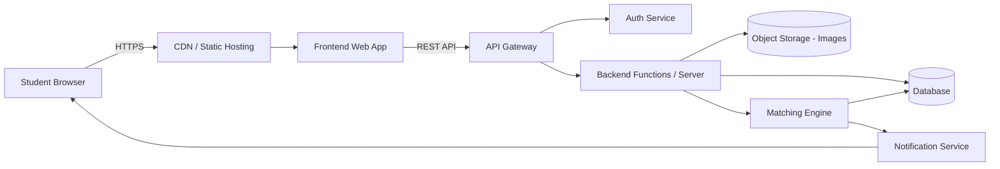
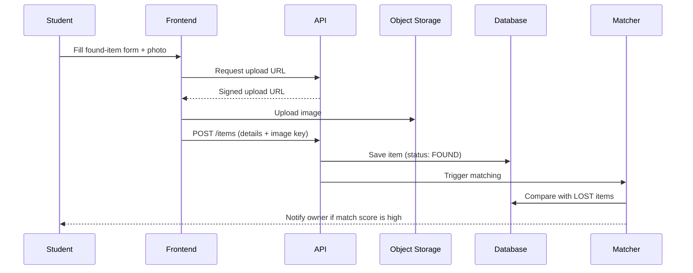
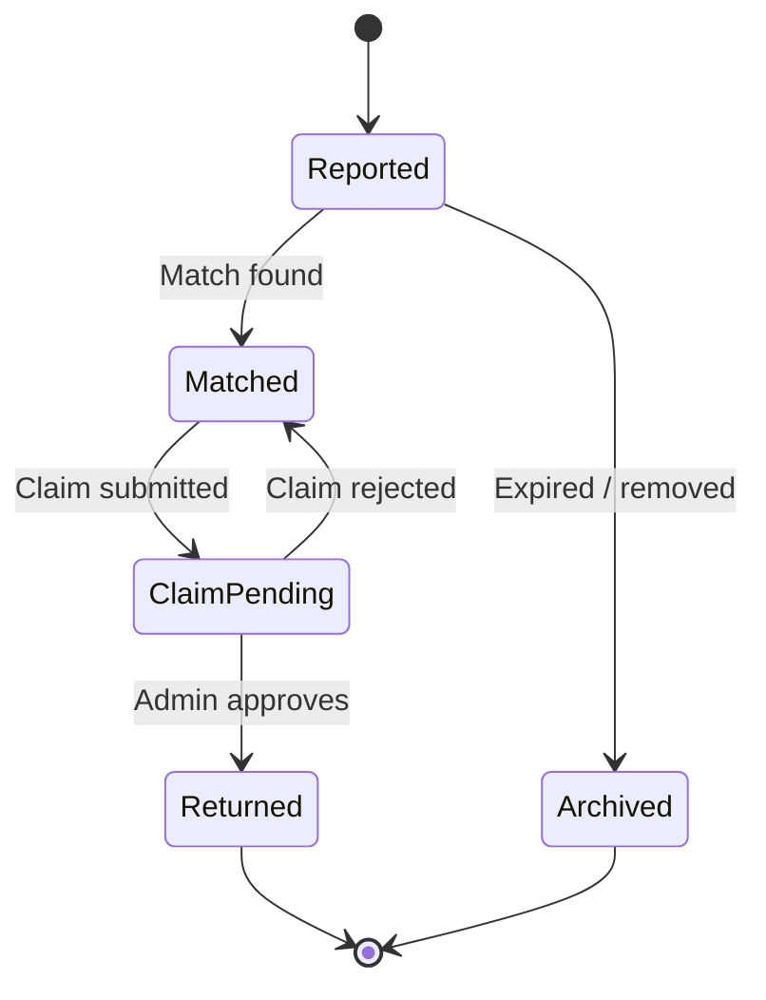

# 🔍 Cloud-Based Lost & Found Management System

> A web platform where students can **report**, **search**, and **manage** lost and found items. Item details and images live securely in the cloud, with smart matching and live status updates.


---

## 📑 Quick Navigation

- [Overview](#-overview)
- [Features](#-features)
- [Architecture](#-architecture)
- [Tech Stack](#-tech-stack)
- [Getting Started](#-getting-started)
- [Usage Guide](#-usage-guide)
- [API Reference](#-api-reference)
- [Database Schema](#-database-schema)
- [Security](#-security)
- [Roadmap](#-roadmap)
- [FAQ](#-faq)
- [Contributing](#-contributing)

---

## 📌 Overview

Losing a phone, ID card, or water bottle on campus is stressful, and notice boards and WhatsApp groups don't scale. This system gives students one central place to:

1. **Report** a lost or found item with photos
2. **Search** and filter all reported items
3. **Get matched** automatically when a lost report resembles a found report
4. **Track** an item from *Reported → Matched → Claimed → Returned*

---

## ✨ Features

<details open>
<summary><b>👤 For Students</b></summary>

- Register / log in with college email
- Report lost items (title, category, description, location, date, photo)
- Report found items and mark where they are being held
- Search by keyword, category, date range, and location
- Receive notifications when a potential match is found
- Submit a claim with proof of ownership
- View history of own reports and claims

</details>

<details>
<summary><b>🛡️ For Admins / Security Desk</b></summary>

- Review and approve or reject claims
- Edit, merge, or remove duplicate / inappropriate listings
- Mark items as returned or archive them
- View dashboard statistics (items reported, returned, pending)

</details>

<details>
<summary><b>☁️ Cloud Capabilities</b></summary>

- Image upload to object storage with secure, time-limited URLs
- Serverless or managed backend that scales with campus traffic
- Managed database with automatic backups
- Email / push notifications via cloud messaging service

</details>

<details>
<summary><b>🤝 Smart Matching</b></summary>

- Compares category, keywords, location, and date proximity
- Produces a **match score** (0-100) between lost and found reports
- Optional: image similarity using a cloud vision service
- Top matches are suggested to both parties

</details>

---

## 🏗️ Architecture



<details>
<summary><b>Request flow: reporting a found item</b></summary>



</details>

---

## 🧰 Tech Stack

| Layer | Suggested Choice | Alternatives |
|---|---|---|
| Frontend | React + Tailwind CSS | Vue, plain HTML/JS |
| Backend | Node.js (Express) or Python (FastAPI) | Serverless functions |
| Database | DynamoDB / PostgreSQL (RDS) | Azure Cosmos DB, Firestore |
| File Storage | AWS S3 | Azure Blob Storage |
| Auth | AWS Cognito | Azure AD B2C, Firebase Auth |
| Notifications | AWS SES / SNS | Azure Communication Services |
| Hosting | S3 + CloudFront, Lambda | Azure Static Web Apps |

> 💡 The design is **cloud-provider agnostic**. Swap services based on your platform.

---

## 🚀 Getting Started

### Prerequisites

- [ ] Node.js 18+ and npm
- [ ] A cloud account (AWS / Azure) with billing alerts enabled
- [ ] Git
- [ ] CLI for your provider (`aws` or `az`) configured

### Installation

<details open>
<summary><b>1. Clone and install</b></summary>

```bash
git clone https://github.com/<your-username>/lost-and-found-cloud.git
cd lost-and-found-cloud

# Frontend
cd frontend && npm install

# Backend
cd ../backend && npm install
```

</details>

<details>
<summary><b>2. Configure environment variables</b></summary>

Create `backend/.env`:

```env
PORT=5000
DB_URL=your_database_connection_string
STORAGE_BUCKET=your_bucket_name
CLOUD_REGION=ap-south-1
JWT_SECRET=change_this_secret
ALLOWED_EMAIL_DOMAIN=yourcollege.edu
NOTIFY_FROM_EMAIL=noreply@yourcollege.edu
```

Create `frontend/.env`:

```env
VITE_API_BASE_URL=http://localhost:5000/api
```

> ⚠️ Never commit `.env` files. Add them to `.gitignore`.

</details>

<details>
<summary><b>3. Provision cloud resources</b></summary>

- [ ] Create a storage bucket (private, block public access)
- [ ] Enable CORS on the bucket for your frontend origin
- [ ] Create the database and tables / collections
- [ ] Set up the auth user pool
- [ ] Verify the sender email for notifications

</details>

<details>
<summary><b>4. Run locally</b></summary>

```bash
# Terminal 1 - backend
cd backend && npm run dev

# Terminal 2 - frontend
cd frontend && npm run dev
```

Open `http://localhost:5173`.

</details>

<details>
<summary><b>5. Deploy</b></summary>

```bash
# Build frontend
cd frontend && npm run build

# Upload build to static hosting, e.g.
aws s3 sync dist/ s3://your-frontend-bucket --delete

# Deploy backend (example: serverless framework)
cd ../backend && npx serverless deploy
```

</details>

---

## 📖 Usage Guide

<details>
<summary><b>Reporting a lost item</b></summary>

1. Log in and click **Report Lost Item**
2. Enter title, category, description, last seen location, and date
3. Upload a photo if you have one (optional)
4. Submit. You will be notified if a similar found item appears

</details>

<details>
<summary><b>Reporting a found item</b></summary>

1. Click **Report Found Item**
2. Add details and a clear photo
3. Mention where the item is now (e.g., Security Office, Library desk)
4. Submit. The owner is notified if there is a match

</details>

<details>
<summary><b>Claiming an item</b></summary>

1. Open the item page and click **Claim**
2. Describe unique identifiers (scratches, wallpaper, contents, serial no.)
3. Admin verifies and approves
4. Collect the item and the status changes to **Returned**

</details>

### Item Lifecycle



---

## 🔌 API Reference

Base URL: `/api`

| Method | Endpoint | Description | Auth |
|---|---|---|---|
| POST | `/auth/register` | Create account | No |
| POST | `/auth/login` | Log in, get token | No |
| GET | `/items` | List / search items | Yes |
| GET | `/items/:id` | Item details | Yes |
| POST | `/items` | Report lost / found item | Yes |
| PUT | `/items/:id` | Update item or status | Owner / Admin |
| DELETE | `/items/:id` | Remove item | Owner / Admin |
| POST | `/uploads/url` | Get signed image upload URL | Yes |
| GET | `/items/:id/matches` | Suggested matches | Yes |
| POST | `/items/:id/claim` | Submit claim | Yes |
| PUT | `/claims/:id` | Approve / reject claim | Admin |

<details>
<summary><b>Example: create an item</b></summary>

**Request**
```http
POST /api/items
Authorization: Bearer <token>
Content-Type: application/json

{
  "type": "LOST",
  "title": "Black Casio Watch",
  "category": "Accessories",
  "description": "Digital watch with cracked strap",
  "location": "Library, 2nd floor",
  "date": "2026-10-18",
  "imageKey": "uploads/abc123.jpg"
}
```

**Response**
```json
{
  "id": "itm_9f2c1",
  "status": "REPORTED",
  "createdAt": "2026-10-20T09:15:00Z"
}
```

</details>

<details>
<summary><b>Example: search items</b></summary>

```http
GET /api/items?type=FOUND&category=Electronics&q=charger&from=2026-10-01
```

</details>

---

## 🗄️ Database Schema

<details>
<summary><b>Users</b></summary>

| Field | Type | Notes |
|---|---|---|
| userId | string (PK) | |
| name | string | |
| email | string | unique, college domain |
| role | enum | STUDENT / ADMIN |
| createdAt | datetime | |

</details>

<details>
<summary><b>Items</b></summary>

| Field | Type | Notes |
|---|---|---|
| itemId | string (PK) | |
| type | enum | LOST / FOUND |
| title | string | |
| category | string | |
| description | text | |
| location | string | |
| date | date | |
| imageKey | string | path in object storage |
| status | enum | REPORTED / MATCHED / CLAIM_PENDING / RETURNED / ARCHIVED |
| reportedBy | string (FK) | userId |
| createdAt | datetime | |

</details>

<details>
<summary><b>Claims</b></summary>

| Field | Type | Notes |
|---|---|---|
| claimId | string (PK) | |
| itemId | string (FK) | |
| claimantId | string (FK) | |
| proofText | text | |
| status | enum | PENDING / APPROVED / REJECTED |
| reviewedBy | string | admin userId |

</details>

<details>
<summary><b>Matches</b></summary>

| Field | Type | Notes |
|---|---|---|
| matchId | string (PK) | |
| lostItemId | string | |
| foundItemId | string | |
| score | number | 0-100 |

</details>

---

## 🔐 Security

- [x] HTTPS everywhere
- [x] Private storage bucket; images served via short-lived signed URLs
- [x] Restrict sign-up to the college email domain
- [x] Role-based access (Student vs Admin)
- [x] Input validation and file type / size limits (e.g., JPG/PNG, max 5 MB)
- [x] Hide sensitive item details (e.g., serial numbers) until a claim is verified
- [ ] Rate limiting on API
- [ ] Automated image moderation

---

## 🗺️ Roadmap

- [x] Project setup and architecture
- [x] User authentication
- [x] Report and list items
- [x] Image upload to cloud storage
- [ ] Search and filters
- [ ] Matching engine (keyword + category + location + date)
- [ ] Notifications
- [ ] Claim and verification flow
- [ ] Admin dashboard
- [ ] Image-similarity matching
- [ ] QR codes for found-item drop boxes
- [ ] Mobile-friendly PWA

---

## ❓ FAQ

<details>
<summary>How are matches calculated?</summary>

A weighted score from category equality, keyword overlap in title/description, distance between locations, and how close the dates are. Scores above a threshold (e.g., 60) trigger notifications.

</details>

<details>
<summary>Who can see the photos?</summary>

Only logged-in users. Images are private and accessed through temporary signed URLs.

</details>

<details>
<summary>What happens to unclaimed items?</summary>

After a set period (e.g., 60 days) items are archived, and the college policy decides final handling.

</details>

<details>
<summary>Will this stay within free-tier limits?</summary>

For a campus-scale project, serverless functions, a small database, and object storage typically fit in free tiers. Set billing alerts anyway.

</details>

---

## 🤝 Contributing

1. Fork the repo
2. Create a branch: `git checkout -b feature/your-feature`
3. Commit: `git commit -m "Add your feature"`
4. Push and open a Pull Request

---

## 👥 Team
| PIYUSHA | Developer |


